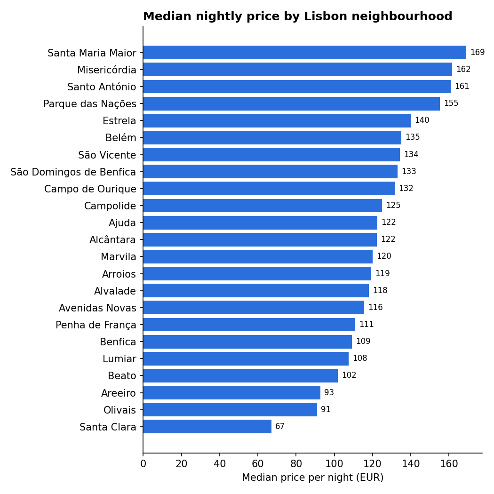
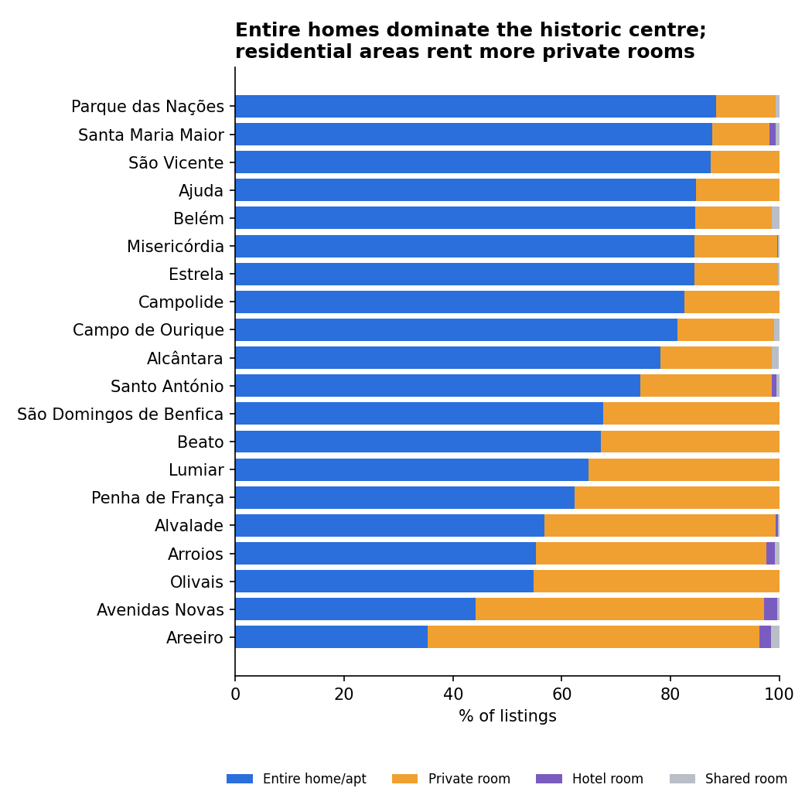
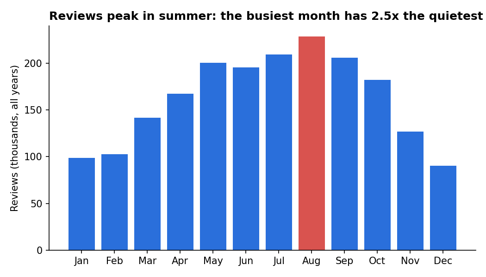
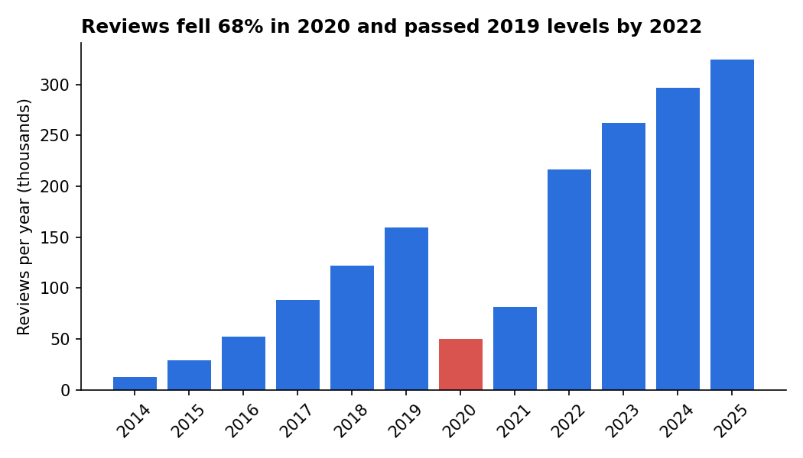
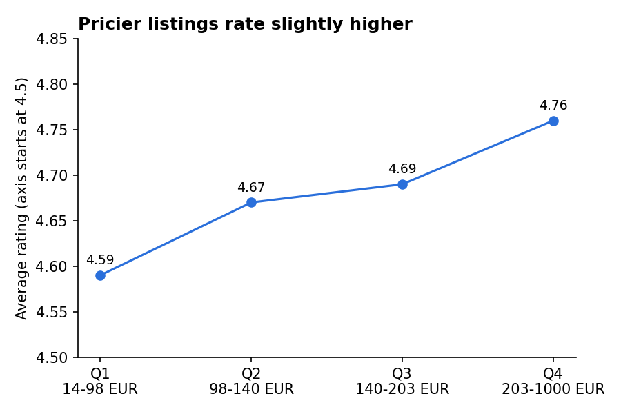

# Airbnb in Lisbon: prices, hosts and seasonality with SQL

What do 25,000 Airbnb listings and 1.9 million reviews say about short-term rentals in the Lisbon region? This project loads the public Inside Airbnb data into MySQL, answers 11 business questions in SQL and turns the results into charts.

## Data

[Inside Airbnb](https://insideairbnb.com/get-the-data/), Lisbon (CC BY 4.0): detailed listings and reviews files.

| Table | Rows | Content |
|---|---|---|
| `listings` | 25,020 | Price, room type, neighbourhood, municipality, rating, availability |
| `hosts` | 9,484 | Host name, since, superhost flag, number of listings |
| `reviews` | 1,948,929 | One row per review (id, listing, date) |
| `neighbourhoods` | 130 | Neighbourhood names |

The file covers 16 municipalities around Lisbon. Neighbourhood questions use only the city itself (`municipality = 'Lisboa'`, 17,153 listings, 69% of the file); host, seasonality and review questions use the whole region.

## Method

1. `load_airbnb_mysql.py` cleans the CSV files with pandas (prices as numbers, dates, superhost flag, restores accents missing in some neighbourhood names) and loads them into four related MySQL tables with primary keys, foreign keys and indexes.
2. `queries.sql` answers 11 questions with joins, CTEs and window functions (`ROW_NUMBER`, `NTILE`, `LAG`, `SUM() OVER`). `run_queries.py` runs them all and saves each result as a CSV.
3. `make_charts.py` draws the figures from those CSVs.

Price questions ignore prices below 10 EUR or above 1,000 EUR per night, which are most likely data errors.

## Findings

**Prices.** The median price per night in Lisbon city is highest in Santa Maria Maior (169 EUR), Misericórdia (162 EUR), Santo António (161 EUR) and Parque das Nações (155 EUR). The cheapest large areas are Areeiro (93 EUR) and Olivais (91 EUR). Averages are higher than medians (Santa Maria Maior: 199 vs 169 EUR), so a minority of expensive listings pulls the mean up.



**Supply is concentrated.** Five parishes (Santa Maria Maior, Misericórdia, Arroios, Santo António and São Vicente) hold about 65% of the city's listings. In the historic centre 84% to 88% of listings are entire homes, while residential areas such as Areeiro (61% private rooms) and Avenidas Novas (53%) rent mostly rooms.



**Seasonality.** Reviews, a proxy for stays, peak in August (228,523) and are lowest in December (90,226), about 2.5 times fewer. July to September are the busiest months.



**COVID and recovery.** Reviews fell 68% from 2019 (159,470) to 2020 (50,316). By 2022 they were above 2019 and in 2025 reached 324,784, about twice the 2019 level.



**Hosts.** Hosts with five or more listings control 56% of the listings that have a price and a host (12,324 of 21,813), yet their average price (172 EUR) is not higher than that of hosts with one listing (177 EUR). Superhosts have a higher average rating (4.84 vs 4.58) and charge about 13% more (186 vs 164 EUR).

**Price and rating.** The average rating rises slightly from the cheapest quarter of listings (4.59) to the most expensive (4.76). The link is weak and does not show that price causes better ratings.



## Limitations

- Reviews are only left by a share of guests, so they approximate demand and do not measure it. Reviews per listing also grow with a listing's age.
- Prices are the advertised prices on the day the data was collected, not what guests paid.
- The data is a snapshot: the latest year (2026) is incomplete and is left out of the growth figures.
- Everything here describes patterns. None of it proves cause and effect.

## Run it

```
pip install pandas mysql-connector-python matplotlib
python load_airbnb_mysql.py data
python run_queries.py queries.sql
python make_charts.py
```

`data/` holds `listings.csv` and `reviews.csv` from Inside Airbnb. A local MySQL 8 server is needed.

## Stack

MySQL 8, Python (pandas, Matplotlib), SQL (CTEs, window functions).
